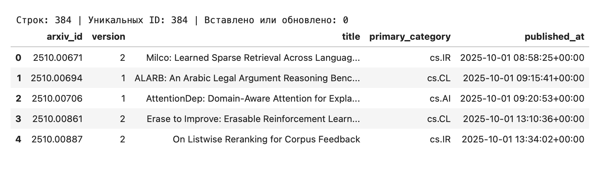

# ДЗ 1. Статьи с arXiv по информационному поиску

Возьмём arXiv за открытый API и удобные ID статей с номером версии. Соберём статьи, которые впервые подали в октябре 2025 года (UTC). Подходят все с меткой `cs.IR`, даже если основная категория другая.

1. Получим статьи из arXiv API.
2. Разберём метаданные в Jupyter Notebook.
3. Запишем статьи в таблицу PostgreSQL `stg.arxiv_papers`.

## Что забираем

Ноутбук ходит в `GET https://export.arxiv.org/api/query` с фильтром `cat:cs.IR AND submittedDate:[202510010000 TO 202510312359]`. Читает по 100 статей за запрос. У меня вышло четыре страницы (100 + 100 + 100 + 84). [Пример запроса на одну статью](https://export.arxiv.org/api/query?search_query=cat%3Acs.IR+AND+submittedDate%3A%5B202510010000+TO+202510312359%5D&start=0&max_results=1&sortBy=submittedDate&sortOrder=ascending)

Кусок ответа для первой статьи

```xml
<id>http://arxiv.org/abs/2511.14768v1</id>
<title>Causally-Informed Reinforcement Learning for Adaptive Emotion-Aware Social Media Recommendation</title>
<published>2025-10-01T05:31:23Z</published>
<category term="cs.IR" scheme="http://arxiv.org/schemas/atom"/>
```

В таблице одна строка на статью. Например, у этой статьи ключ `2511.14768` и версия `1`. Если придёт `v2`, ноутбук обновит ту же строку.

| Из ответа arXiv | В PostgreSQL |
|---|---|
| `id` (URL с версией) | `arxiv_id text PRIMARY KEY`, `version integer` |
| `title`, `summary` (текст) | `title text`, `abstract text` |
| `author/name` (список имён) | `authors text[]` |
| `arxiv:primary_category/@term` (строка) | `primary_category text` |
| `category/@term` (список меток) | `categories text[]` |
| `published`, `updated` (дата и время) | `published_at timestamptz`, `updated_at timestamptz` |
| `link[@rel="alternate"]/@href` (URL) | `article_url text` |

## Как запустить

Проверено на macOS с Python 3.13 и Podman. Установим Podman и Compose командой `brew install podman docker-compose`. Проверим список машин через `podman machine list`. Если список пуст, создадим машину командой `podman machine init`. Если машина остановлена, запустим её через `podman machine start`.

```sh
git clone https://github.com/n1kstep/de-hw-01.git
cd de-hw-01
test -f .env || (umask 077 && sed "s/^POSTGRES_PASSWORD=$/POSTGRES_PASSWORD=$(openssl rand -hex 24)/" .env.example > .env)
podman compose up -d --wait

python3 -m venv .venv
source .venv/bin/activate
python -m pip install -r requirements.txt
jupyter lab notebooks/etl.ipynb
```

На пустом томе PostgreSQL сам создаёт таблицу. В Jupyter выберем **Run → Run All Cells**. Если запускаем из терминала, выполним команду ниже дважды в активированном окружении.

```sh
jupyter nbconvert --to notebook --execute --inplace --ExecutePreprocessor.timeout=180 notebooks/etl.ipynb
```

## Что получилось

Первый прогон записал 384 статьи в пустую таблицу. Второй снова прочитал все четыре страницы и записал 0 строк. В базе осталось **384 строки и 384 разных ID**. Проверим оба числа одним SQL-запросом.

```sh
podman compose exec -T postgres sh -c 'psql -U "$POSTGRES_USER" -d "$POSTGRES_DB" -c "SELECT COUNT(*), COUNT(DISTINCT arxiv_id) FROM stg.arxiv_papers;"'
```



## Что можно улучшить

Если arXiv вернёт `429` или `503` на четвёртой странице, сейчас придётся читать все страницы заново. Можно добавить паузу и повторить только упавший запрос.
